# ER Diagram

Generated from the live schema after migrations 001 to 022 (public and auth schemas).

```mermaid
erDiagram

    ACCOUNTS {
        BIGINT id PK
        VARCHAR_32 account_id UK
        VARCHAR_255 holder_name
        NUMERIC_18_2 cash_balance
        VARCHAR_20 status
        INT version
        TIMESTAMP last_updated
    }

    INSTRUMENTS {
        VARCHAR_20 symbol PK
        VARCHAR_255 instrument_name
        VARCHAR_20 asset_class
        CHAR_3 currency
        BOOLEAN tradable
    }

    ORDERS {
        UUID id PK
        BIGINT account_id FK
        VARCHAR_20 symbol FK
        VARCHAR_4 side
        INT quantity
        NUMERIC_18_2 price
        VARCHAR_20 status
        VARCHAR_100 idempotency_key UK
        TIMESTAMP created_on
        NUMERIC_18_2 executed_price
        INT filled_quantity
        TIMESTAMP updated_on
        VARCHAR_255 rejection_reason
        TIMESTAMP executed_on
        NUMERIC_18_6 fx_rate
    }

    POSITIONS {
        BIGINT account_id PK, FK
        VARCHAR_20 symbol PK, FK
        INT quantity
        NUMERIC_18_2 average_cost
        INT version
    }

    TRADES {
        UUID id PK
        UUID order_id FK, UK
        INT quantity
        NUMERIC_18_2 execution_price
        VARCHAR_100 broker_reference
        TIMESTAMP executed_at
        NUMERIC_18_6 fx_rate
    }

    ACCOUNT_TRANSACTIONS {
        BIGINT id PK
        BIGINT account_id FK
        VARCHAR_30 transaction_type
        NUMERIC_18_2 amount
        VARCHAR_30 reference_type
        VARCHAR_100 reference_id
        TIMESTAMP created_at
    }

    FX_RATES {
        VARCHAR_10 pair PK
        DATE rate_date PK
        NUMERIC_18_6 rate
        TIMESTAMP quote_as_of
        TIMESTAMP fetched_on
    }

    MARKET_HOLIDAYS {
        VARCHAR_10 market PK
        DATE holiday_date PK
        VARCHAR_100 name
        TIMESTAMP created_on
    }

    MARKET_PRICE {
        VARCHAR_20 symbol PK, FK
        NUMERIC_18_4 last_price
        NUMERIC_18_4 bid
        NUMERIC_18_4 ask
        CHAR_3 currency
        NUMERIC_18_4 change
        NUMERIC_9_4 change_percent
        NUMERIC_18_4 previous_close
        VARCHAR_10 market_state
        BOOLEAN stale
        TIMESTAMP quote_as_of
        TIMESTAMP updated_on
    }

    PRICE_HISTORY {
        BIGINT id PK
        VARCHAR_20 symbol FK
        NUMERIC_18_4 price
        NUMERIC_18_4 bid
        NUMERIC_18_4 ask
        TIMESTAMP quote_as_of
        TIMESTAMP recorded_on
    }

    CANDLE_CACHE {
        VARCHAR_20 symbol PK
        VARCHAR_10 interval
        CHAR_3 currency
        TEXT candles_json
        TIMESTAMP fetched_at
        TIMESTAMP expires_at
    }

    WATCHLISTS {
        BIGINT id PK
        BIGINT account_id FK, UK
        VARCHAR_100 name UK
        TIMESTAMP created_on
    }

    WATCHLIST_ITEMS {
        BIGINT watchlist_id PK, FK
        VARCHAR_20 symbol PK, FK
        TIMESTAMP added_on
        INT position
        VARCHAR_50 flag
    }

    PRICE_ALERTS {
        BIGINT id PK
        BIGINT account_id FK
        VARCHAR_20 symbol FK
        VARCHAR_5 direction
        NUMERIC_18_4 target_price
        VARCHAR_10 status
        TIMESTAMP created_on
        TIMESTAMP triggered_on
        NUMERIC_18_4 triggered_price
    }

    PRICE_ALERT_STATE {
        BIGINT alert_id PK, FK
        NUMERIC_18_4 last_observed_price
        TIMESTAMP updated_on
    }

    NOTIFICATIONS {
        UUID id PK
        BIGINT account_id FK
        UUID source_event_id UK
        VARCHAR_40 type
        VARCHAR_10 channel
        VARCHAR_160 subject
        VARCHAR_1000 message
        VARCHAR_10 delivery_state
        TIMESTAMP read_on
        TIMESTAMP created_on
        UUID order_id
        BIGINT alert_id
        VARCHAR_20 symbol
    }

    CUSTOMER_PREFERENCES {
        BIGINT account_id PK, FK
        BIGINT default_account_id FK
        VARCHAR_10 notification_channel
        VARCHAR_320 contact_email
        VARCHAR_32 contact_phone
        CHAR_3 display_currency
        VARCHAR_10 theme
        TIMESTAMP updated_on
        VARCHAR_20 avatar_key
    }

    TRADE_SIGNAL {
        VARCHAR_20 symbol PK
        VARCHAR_4 direction
        NUMERIC_6_4 strength
        VARCHAR_500 rationale
        TIMESTAMP computed_at
        TIMESTAMP expires_at
    }

    TRADING_STRATEGY {
        BIGINT id PK
        BIGINT account_id FK
        VARCHAR_20 symbol
        VARCHAR_4 side
        VARCHAR_10 strategy_type
        INT fast_window
        INT slow_window
        INT band_period
        NUMERIC_4_2 band_multiplier
        INT order_quantity
        NUMERIC_18_2 max_spend
        INT max_position_size
        INT max_consecutive_failures
        INT consecutive_failures
        VARCHAR_10 status
        VARCHAR_200 disabled_reason
        TIMESTAMP created_on
        TIMESTAMP updated_on
    }

    STRATEGY_EXECUTION_LOG {
        BIGINT id PK
        BIGINT strategy_id FK
        TIMESTAMP triggered_at
        NUMERIC_18_4 triggering_price
        VARCHAR_20 action
        VARCHAR_10 outcome
        VARCHAR_300 detail
        UUID order_id
    }

    PROCESSED_EVENTS {
        VARCHAR_40 consumer_name PK
        UUID event_id PK
        TIMESTAMP processed_on
    }

    AUTH_USERS {
        UUID id PK
        VARCHAR_64 username UK
        TEXT password_hash
        BIGINT account_id UK
        ARRAY roles
        TIMESTAMPTZ created_at
    }

    AUTH_REFRESH_TOKENS {
        UUID id PK
        UUID user_id FK, UK
        TEXT token_hash
        BOOLEAN revoked
        TIMESTAMPTZ created_at
        TIMESTAMPTZ hard_expiry
        TIMESTAMPTZ updated_at
    }

    ACCOUNTS ||--o{ ACCOUNT_TRANSACTIONS : moves_cash_via
    ACCOUNTS ||--o| CUSTOMER_PREFERENCES : prefers
    ACCOUNTS ||--o{ NOTIFICATIONS : receives
    ACCOUNTS ||--o{ ORDERS : places
    INSTRUMENTS ||--o{ ORDERS : ordered_for
    ACCOUNTS ||--o{ POSITIONS : holds
    INSTRUMENTS ||--o{ POSITIONS : held_as
    ORDERS ||--o| TRADES : executed_as
    INSTRUMENTS ||--o| MARKET_PRICE : latest_quote
    INSTRUMENTS ||--o{ PRICE_HISTORY : quote_history
    ACCOUNTS ||--o{ WATCHLISTS : owns
    WATCHLISTS ||--o{ WATCHLIST_ITEMS : contains
    INSTRUMENTS ||--o{ WATCHLIST_ITEMS : watched_as
    ACCOUNTS ||--o{ PRICE_ALERTS : configures
    INSTRUMENTS ||--o{ PRICE_ALERTS : alerted_on
    PRICE_ALERTS ||--o| PRICE_ALERT_STATE : tracked_by
    ACCOUNTS ||--o{ TRADING_STRATEGY : runs
    TRADING_STRATEGY ||--o{ STRATEGY_EXECUTION_LOG : logs
    AUTH_USERS ||--o{ AUTH_REFRESH_TOKENS : issues
```

## Notes

- Money is exact decimal everywhere. INR holds all cash; `FX_RATES` stores the daily USD/INR pair, and orders and trades keep the `fx_rate` locked when a dollar order is placed (migrations 020 and 021).
- `ORDERS.executed_price` and `ORDERS.filled_quantity` (migration 006) duplicate `TRADES.execution_price` and `TRADES.quantity` for a filled order. They stay because the order mapper still reads them; see `normalisation.md`.
- `AUTH_USERS.account_id` is unique and points at an account, but it is not a database foreign key: the auth service owns its schema and checks the account through the Trade API.
- `PROCESSED_EVENTS` and `CANDLE_CACHE` stand alone on purpose: one records Kafka events already handled, the other caches Fauxnance candles.
- `STRATEGY_EXECUTION_LOG.outcome` allows PLACED, REJECTED and SKIPPED (migration 022).
